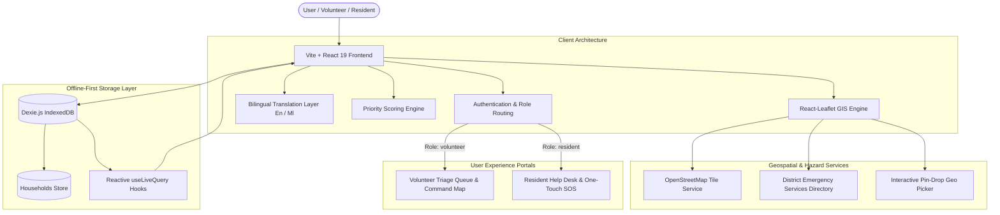

# 🚨 Karuthal (കരുതൽ)
### *Ayalkkaare Ariyaam, Aadyam Ethaam — Know Your Neighbours, Reach Them First*

[](https://react.dev/)
[](https://vitejs.dev/)
[](https://leafletjs.com/)
[](https://dexie.org/)
[](https://opensource.org/licenses/MIT)
[-green)](#-bilingual-support)

---

## 📌 Executive Summary

**Karuthal (കരുതൽ)** is a resilient, offline-first, hyper-local disaster triage and community emergency coordination platform engineered specifically for disaster-vulnerable regions of **Kerala** (such as landslide-prone slopes of **Wayanad**, high-range catchment zones of **Idukki**, and low-lying backwater floodplains of **Alappuzha / Kuttanad**).

When flash floods, cloudbursts, or landslides strike, standard emergency infrastructure faces severe bottlenecks: network drops, chaotic phone lines, and lack of ground truth regarding who needs help first. **Karuthal** bridges this critical gap by prioritizing rescue efforts using a **real-time mathematical vulnerability scoring engine**, dynamic pin-drop geospatial mapping, and an accessible dual-persona portal (Volunteer Responders & Elderly/Isolated Residents).

---

## 🌟 Key Highlights & Innovations

- 🧠 **Dynamic Time-Decayed Priority Engine**: Mathematical algorithm evaluating medical urgency, physical mobility, isolation, flood hazard, and elapsed check-in decay (points automatically scale up if no contact is logged).
- 🗺️ **High-Precision Geospatial Mapping**: Powered by **Leaflet & OpenStreetMap** with custom vector pins, live pulsing distress beacons, coordinate pin-drop mode, and district-level hazards.
- 🏥 **Comprehensive Emergency Services POIs**: Integrated directory with geo-markers for 24x7 Trauma Hospitals (`H`), Primary Health Clinics (`C`), Fire & Rescue Stations (`F`), and Wheelchair/Ambulance Transport services.
- 👵 **Elderly-Friendly Resident Portal**: Low-cognitive load interface with one-touch SOS distress triggers, "I Am Safe" check-in, and frictionless login using **Name + Date of Birth (DOB)**.
- 🌐 **Full Bilingual Experience**: Seamless instant toggle between **English** and **മലയാളം (Malayalam)** for field teams and local citizens.
- 💾 **100% Offline-First (Local Persistence)**: Leverages **IndexedDB via Dexie.js** and reactive hooks (`useLiveQuery`), guaranteeing full operational capability during severe telecom infrastructure failure.

---

## 🏗️ System Architecture



---

## 📐 Priority Scoring & Triage Algorithm

Karuthal replaces arbitrary rescue triage with an objective, data-backed scoring formula:

$$\text{Priority Score} = (\text{MedicalNeed} \times 3) + (\text{Mobility} \times 2) + (\text{LivesAlone} \times 2) + (\text{LowLying} \times 2) + \frac{\min(\text{HoursSinceCheckIn}, 24)}{4}$$

### 📊 Score Factor Weights

| Parameter | Scale | Weight Multiplier | Max Points | Description |
| :--- | :---: | :---: | :---: | :--- |
| **Medical Need** | $0 - 3$ | $\times 3$ | **9.0** | Critical oxygen dependence, dialysis, insulin, life support |
| **Mobility Impairment** | $0 - 3$ | $\times 2$ | **6.0** | Bedridden, non-ambulatory, wheelchair-bound |
| **Lives Alone** | Boolean | $+2$ | **2.0** | Elderly or isolated citizen without caregiver support |
| **Low-Lying / Hazard Zone** | Boolean | $+2$ | **2.0** | Proximity to riverbanks, flood basins, or landslide slips |
| **Check-In Time Decay** | $0 - 24\text{ hrs}$ | $\frac{1}{4}\text{ per hr}$ | **6.0** | Urgency climbs as hours elapse without confirmed contact |

### 🚨 Classification Tiers & Visual Indicators

| Priority Tier | Score Threshold | Color Code | Map Indicator | Operational Directive |
| :--- | :---: | :---: | :---: | :--- |
| 🔴 **Critical / Urgent** | $\ge 11.0$ *or SOS active* | `#ef4444` | Pulsing Beacon Ring | Immediate first-responder rescue deployment |
| 🟠 **Moderate / Watch** | $6.0 - 10.9$ | `#f59e0b` | Amber Solid Pin | Needs welfare visit / supply delivery within 6 hrs |
| 🟢 **Low / Stable** | $< 6.0$ | `#10b981` | Emerald Solid Pin | Low immediate risk; remote welfare check |
| 🔵 **Evacuated** | State Override | `#3b82f6` | Safe Checkmark Pin | Safely relocated to relief camp / shelter |

---

## 👥 Dual-Persona Portals & Demo Credentials

The platform features tailored experiences for field personnel and affected families:

### 1. 🛡️ Volunteer & First Responder Portal
- **Triage Queue**: Auto-sorted descending by calculated priority score.
- **Instant Status Transition**: Switch states with a single click (`Needs urgent help`, `Contacted`, `Visited`, `Evacuated`).
- **"Log Check-In Now"**: Instantly resets the time-decay factor upon physical or telephonic contact.
- **Pin-Drop Registration**: Add unlisted vulnerable residents by dropping a pin anywhere on the interactive map.

| Role | Username | Password | Assigned District |
| :--- | :--- | :--- | :--- |
| **Lead Field Coordinator** | `rahul_rescuer` | `rescue@2026` | Wayanad |
| **Civil Defense Volunteer** | `kavya_kfd` | `kerala#safe` | Idukki |
| **Community Responder** | `anand_volunteer` | `wayanad123` | Alappuzha |

### 2. 👵 Resident & Elderly Emergency Help Desk
- **Low Barrier Access**: No complex passwords to memorize. Log in with **Name + Date of Birth (DOB)**.
- **One-Touch SOS**: Triggers instant emergency broadcast with medical status flags.
- **"I Am Safe" Button**: Reassures rescue teams and updates household status to Contacted/Visited.
- **Direct-Dial Kerala Helplines**: 1077 (Disaster Control), 108 (Ambulance), 112 (Police), 101 (Fire Force).

| Demo Resident | Date of Birth (Password) | District | Context |
| :--- | :--- | :--- | :--- |
| **Mariyamma Thomas** | `15/03/1940` (or `1940-03-15`) | Wayanad (Meppadi) | 84-year-old living alone near riverbank |

---

## 📍 Kerala District Disaster Hazard Coverage

Karuthal provides pre-configured geo-centers, zoom levels, and hazard contexts for Kerala's most vulnerable zones:

```
├── ⛰️ Wayanad (വയനാട്)
│   ├── Hazard: Landslide, debris flow & flash flood slopes
│   └── Localities: Meppadi, Chooralmala, Mundakkai, Kalpetta
│
├── 🌊 Idukki (ഇടുക്കി)
│   ├── Hazard: High-range dam catchment overflow & hill slope hazards
│   └── Localities: Cheruthoni, Munnar, Vandiperiyar, Adimali
│
└── 🛶 Alappuzha (ആലപ്പുഴ)
    ├── Hazard: Kuttanad below-sea-level low-lying backwater floodplains
    └── Localities: Kuttanad, Champakulam, Edathua, Pulinkunnu
```

---

## 🛠️ Tech Stack & Dependencies

| Layer | Technology | Purpose |
| :--- | :--- | :--- |
| **Core Framework** | [React 19](https://react.dev/) + [Vite 8](https://vitejs.dev/) | High-performance reactive frontend build |
| **GIS & Mapping** | [Leaflet](https://leafletjs.com/) + [React-Leaflet 5](https://react-leaflet.js.org/) | Responsive interactive cartography & vector layers |
| **Local Database** | [Dexie.js 4](https://dexie.org/) (`dexie-react-hooks`) | IndexedDB wrapper enabling offline-first zero latency |
| **Icons & Design** | [Lucide React](https://lucide.dev/) | Clean, accessible disaster response iconography |
| **Linter & Code Quality** | [Oxlint](https://oxc.rs/) | Fast, high-standard JavaScript/React linting |
| **Styling** | Modern Vanilla CSS | Dark/slate tactical UI, glassmorphic HUDs, high contrast |

---

## 🚀 Getting Started

### Prerequisites
- **Node.js**: v18.0.0 or higher
- **npm**: v9.0.0 or higher

### Installation

1. **Clone the repository:**
   ```bash
   git clone https://github.com/akhilesh2007-r/Karuthal.git
   cd Karuthal
   ```

2. **Install dependencies:**
   ```bash
   npm install
   ```

3. **Launch development server:**
   ```bash
   npm run dev
   ```
   Open [http://localhost:5173](http://localhost:5173) in your browser.

4. **Lint code:**
   ```bash
   npm run lint
   ```

5. **Build for production:**
   ```bash
   npm run build
   ```

---

## 📁 Project Directory Structure

```text
Karuthal/
├── index.html                   # HTML5 entry with Leaflet stylesheet links
├── package.json                 # Manifest & dependencies
├── vite.config.js               # Vite bundler configuration
├── .oxlintrc.json               # Oxlint configuration
├── public/                      # Static assets & SVG icons
│   ├── favicon.svg
│   └── icons.svg
└── src/
    ├── main.jsx                 # Application entry point
    ├── App.jsx                  # Root state, auth routing & live queries
    ├── App.css                  # Core component layout styles
    ├── index.css                # Design system, tactical theme & pulse animations
    ├── components/
    │   ├── Header.jsx           # Brand, district selector & language toggle
    │   ├── MapView.jsx          # Leaflet map, emergency POIs & pin-drop engine
    │   ├── TriageSidebar.jsx    # Priority queue, filters & search bar
    │   ├── ResidentPortal.jsx   # Elder emergency help desk & one-touch SOS
    │   ├── LoginScreen.jsx      # Role switcher (Volunteer vs Resident)
    │   ├── AddHouseholdModal.jsx# Register vulnerable households with pin-drop
    │   └── HouseholdDetailModal.jsx # Responders' deep-dive & status updater
    ├── db/
    │   └── db.js                # Dexie IndexedDB schemas & sample seed data
    └── utils/
        ├── auth.js              # Credentials & flexible date parser (DD/MM/YYYY)
        ├── districts.js         # Kerala district hazard profiles & coordinates
        ├── emergencyServices.js # Hospitals, Clinics, Fire Stations & Ambulances
        ├── priority.js          # Mathematical priority score calculation
        └── translations.js      # English & Malayalam bilingual strings
```

---

## 🧪 Interactive Demo Walkthrough

1. **Simulate Resident Distress Call**:
   - Open [http://localhost:5173](http://localhost:5173).
   - Click **"Individual / Resident"** tab on the login screen.
   - Enter Name: `Mariyamma Thomas` and DOB: `15/03/1940`.
   - In the Resident Portal, tap the big red **"Request Urgent Help (സഹായം വേണം)"** button.
   - Select critical needs (e.g., Bedridden, Flood water rising) and submit SOS.
   - Note the real-time status change to **"Needs urgent help"**.

2. **Respond as Field Volunteer Coordinator**:
   - Log out and sign in using **Volunteer Portal** (`rahul_rescuer` / `rescue@2026`).
   - Notice **Mariyamma Thomas** instantly jumps to the **top of the Priority Triage Sidebar** with a score of $14+$ and a flashing crimson indicator.
   - Look at the interactive map: her location pin is surrounded by an active **pulsing red beacon**.
   - Click her card or marker to view the **Emergency Inspector**.
   - Review nearest emergency services: hospitals (`H`), clinics (`C`), and specialized transport.
   - Click **"Log Check-In Now"** or mark as **"Visited" / "Evacuated"**.
   - Watch the score update reactively and the pin change to blue/emerald.

3. **Try Pin-Drop Household Registration**:
   - Click **"+ Add Household"** in the top header.
   - Click **"📍 Drop Pin on Map"**.
   - Click anywhere on the map to pick exact geographic coordinates.
   - Adjust medical and mobility vulnerability sliders and save.

---

## 🔮 Roadmap & Future Enhancements

- [ ] **Offline Mesh Networking**: Peer-to-peer relay via WebRTC / Bluetooth Low Energy (BLE) when cellular towers collapse.
- [ ] **Kerala SDMA Integration**: Real-time river water gauge alerts from the Central Water Commission (CWC).
- [ ] **Automated IVR / SMS Gateway**: Voice telephone check-ins for non-smartphone seniors.
- [ ] **Relief Camp Capacity Tracking**: Live bed and medicine inventory for official rehabilitation centers.

---

## 🤝 Contributing

Contributions are warmly welcomed! Feel free to:
1. Fork the Project.
2. Create your Feature Branch (`git checkout -b feature/AmazingFeature`).
3. Commit your Changes (`git commit -m 'Add some AmazingFeature'`).
4. Push to the Branch (`git push origin feature/AmazingFeature`).
5. Open a Pull Request.

---


<div align="center">
  <b>Built with care for Kerala 🌴 | Nexathon Project</b><br>
  <i>"Karuthal: Because in a crisis, every second and every neighbor counts."</i>
</div>
